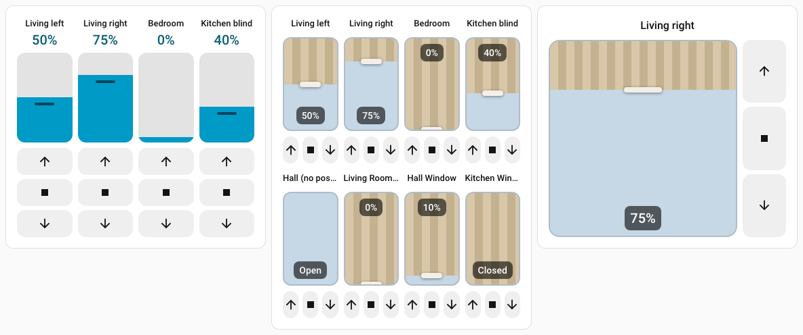
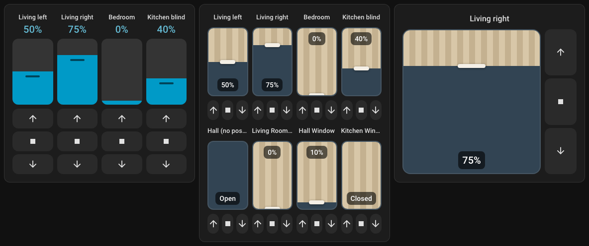

# Curtain Control Card

A Home Assistant dashboard card that controls 1–8 curtains (`cover` entities) with vertical
sliders, built for wall panels such as the Shelly Wall Display X2.

> Work in progress — not released yet.




## Why

Wall panels need big, direct controls. Each curtain gets its own slider: tap anywhere on it to
jump to that position, or drag. The card sends exactly one `cover.set_cover_position` when you
let go, never a stream of commands, and the page never scrolls while you drag. Open, stop and
close buttons sit under every slider.

## Install

**HACS (custom repository):** HACS → ⋮ → Custom repositories → add this repository's URL with
type _Dashboard_, then install **Curtain Control Card** and reload the browser.

**Home Assistant Marketplace (2026.11+):** once listed, install it from the Marketplace like any
other dashboard card.

**Manual:** download `curtain-control-card.js` from the latest release into
`<config>/www/`, then add it under Settings → Dashboards → ⋮ → Resources as
`/local/curtain-control-card.js` (JavaScript module).

Then add the card from the dashboard editor ("Curtain control") or in YAML.

## Configuration

```yaml
type: custom:curtain-control-card
entities:
  - cover.living_left
  - entity: cover.living_right
    name: Right
style: fabric
theme: auto
height: 360px
```

| Key        | Values                                                | Default                    |
| ---------- | ----------------------------------------------------- | -------------------------- |
| `entities` | 1–8 cover ids, or `{ entity, name }`                  | required                   |
| `style`    | `pill` or `fabric`                                    | `pill`                     |
| `theme`    | `auto` (follow the HA theme), `light` or `dark`       | `auto`                     |
| `height`   | any CSS length; a plain number means px. Masonry only | `360px`                    |
| `accent`   | any CSS colour                                        | the theme's primary colour |

In Sections dashboards the card fills its grid cell and `height` is ignored. Narrow cards wrap
the curtains into two rows. Everything is also editable in the visual editor.

## Compatibility

Tested automatically against real Home Assistant in Docker (`npm run e2e`, see below):

| Home Assistant | Masonry | Sections | Themes (light, dark, custom) | Visual editor | Shelly emulation |
| -------------- | ------- | -------- | ---------------------------- | ------------- | ---------------- |
| 2024.8.0 (min) | ✓       | ✓        | ✓                            | ✓             | ✓                |
| 2026.11.2      | ✓       | ✓        | ✓                            | ✓             | ✓                |

The Shelly checks emulate the panel (1440 × 720, touch, Android WebView user agent, and an engine
without `color-mix()`). Emulation cannot prove the Shelly's own screen-switch swipe, the real
WebView version or real performance; those are checked on the device.

## Development

```sh
npm install
npm run check   # lint, types, unit tests with coverage
npm run build   # dist/curtain-control-card.js
npm run dev     # rebuild on change; harness in dev/ (see dev/README.md)
```

End-to-end tests against real Home Assistant (needs Docker):

```sh
npx playwright install chromium   # once
npm run build
npm run ha:up -- 2024.8.0 8124
npm run ha:up -- stable 8125
npm run e2e
npm run ha:down
```

`ha:up` starts a fresh instance with the demo covers from `dev/`, and the test setup onboards it
headlessly. Point the tests elsewhere with
`HA_TARGETS="<version>=<url>,…"`.

## License

MIT

## Security notes

- `overrides` pins `minimatch` ≥ 11.0.1 under `@typescript-eslint/typescript-estree` and `eslint` for
  [GHSA-g3hv-75wg-m249](https://github.com/advisories/GHSA-g3hv-75wg-m249) (dev dependency only).
- The bundle is built with esbuild instead of Rollup because `@rollup/plugin-node-resolve`
  depends on `deepmerge`, which has an unpatched advisory
  ([GHSA-gcqx-w48m-w2h4](https://github.com/advisories/GHSA-gcqx-w48m-w2h4)).
